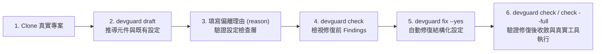

# KEI-6 真實專案測試報告（Real-Project Test Report）

- **對應議題**：`KEI-6`（使用真實專案測試）
- **測試分支**：`lochaowei/kei-6-使用真實專案測試`（PR [#31](https://github.com/lochaowei/devguard/pull/31)）
- **適用標準**：`team@1.0.0`
- **測試環境**：Windows 11 (`win32`)、Node.js `v24.21.0`、Python `3.14.7` (`uv`)、Go `1.26`

> [!NOTE]
> 本報告記錄 `devguard` 針對自身專案（Dogfooding）以及 4 種支援語言（Python、Go、TypeScript、Java）共 9 個公開開源專案執行完整工作流程（`devguard draft` → `devguard check` → `devguard fix --yes` → `devguard check --full`）的實測過程、發現的邊界問題、修復內容與回歸測試對照，供後續版本迭代與標準演進參考。

---

## 1. 測試流程與方法論



每個受測專案皆依序驗證以下檢查層與工具鏈行為：

1. **元件與設定推導（`draft`）**：驗證 [`inferComponents`](../src/draft.ts) 與 [`draftDeclaration`](../src/draft.ts) 能否正確識別單一元件、多模組建置與混合語言/建置工具之子元件，並將非預設工具選項與放寬項目寫入 `.devguard.yaml`。
2. **設定檢查層（`config` / `consistency`）**：驗證 `.devguard.yaml`、`pyproject.toml`、`.golangci.yml`、`go.mod`、`tsconfig.json`、`eslint.config.*`、`.prettierrc`、`biome.json`、`vitest.config.*`、`pom.xml`、`build.gradle(.kts)`、`checkstyle.xml`、`pmd-ruleset.xml`、`.gitattributes` 與 lockfile / 工具版本鎖定。
3. **自動修復（`fix --yes`）**：驗證 [`runFix`](../src/fix/run.ts) 對 CLI 託管檔（如 `checkstyle.xml`、`pmd-ruleset.xml`）與結構化設定檔（`pyproject.toml`、`.golangci.yml`、`tsconfig.json`、`.prettierrc`、`biome.json`、`.gitattributes`）的編輯是否保留註解與排版，且**絕不自動覆寫**建置檔（`pom.xml`、`build.gradle`）或程式碼型設定檔（`eslint.config.js`、`vitest.config.ts`）。
4. **程式碼與測試執行層（`code` / `tests`）**：在具備對應工具鏈的專案上實際執行 `ruff`、`mypy`、`pytest --cov`、`go test -coverprofile`、`go tool cover`、`go mod tidy -diff`、`eslint`、`prettier`、`tsc --noEmit`、`vitest --coverage`。

---

## 2. 受測專案總覽矩陣

| 語言 | 專案名稱 | 元件結構 | 套件 / 建置工具 | 實測涵蓋層級 | 修復前 Findings | `fix --yes` 自動修復數 | 修復後剩餘 Findings |
| :--- | :--- | :--- | :--- | :--- | :---: | :---: | :--- |
| **TypeScript** | `lochaowei/devguard` | 單一元件 (`./`) | `npm` (`package-lock.json`) | `draft` / `check` / `fix` / `check --full` / `t2:probe` | 1 (`hint`) | 0 | **0 錯誤、0 偏離、1 提示** |
| **Python** | `encode/httpx` | 單一元件 (`./`) | `uv`（缺 `uv.lock`） | `draft` / `check` / `fix` / `check --full`（建立 `.venv` 後） | 6 | 3 | 1 錯誤 (`lockfile-missing`)、1 偏離、1 提示 |
| **Python** | `pydantic/pydantic-settings` | 單一元件 (`./`) | `uv` (`uv.lock`) | `draft` / `check` / `fix` / `check --full` | 6 | 2 | 2 錯誤 (`tool-version`)、2 偏離、1 提示 |
| **Go** | `fatih/color` | 單一元件 (`./`) | `go.mod` / `go.sum` | `draft` / `check` / `fix` / `check --full` (`go test` / `go mod tidy`) | 4 | 2 | 1 錯誤 (`go-mod-untidy`)、1 偏離 |
| **Go** | `spf13/cobra` | 單一元件 (`./`) | `go.mod` / `go.sum` | `draft` / `check` / `fix` / `check --full` (`go test` / `go mod tidy`) | 13 | 11 | 1 錯誤 (`go-mod-untidy`)、1 偏離 |
| **TypeScript** | `unjs/defu` | 單一元件 (`./`) | `pnpm` (`pnpm-lock.yaml`) | `draft` / `check` / `fix` / `check --full` (`pnpm` 安裝後） | 8 | 5 | 3 錯誤（缺 `eslint` / `vitest` 設定檔、版本超界） |
| **TypeScript** | `sindresorhus/ky` | 單一元件 (`./`) | `npm`（缺 `package-lock.json`） | `draft` / `check` / `fix` | 8 | 1 | 3 錯誤（缺 lockfile / `eslint` / `vitest`）、4 提示 |
| **Java** | `spring-projects/spring-petclinic` | 單一元件 (`./`) | Maven + `mvnw` | `draft` / `check` / `fix` | 4 | 3 | 1 錯誤 (`enforcer-rule-missing`) |
| **Java** | `google/gson` | Maven 多模組 (`./`) | Maven（無 `mvnw`） | `draft` / `check` / `fix` | 8 | 3 | 4 錯誤（缺 `mvnw`、Enforcer、`junit:junit`、插件版本）、1 偏離 |
| **Java** | `junit-team/junit5-samples` | 7 個子元件（Maven + Gradle 混合） | Maven + Gradle (`gradlew`) | `draft` / `check` / `fix` | 31 | 15 | 11 錯誤（Gradle lockfile、Enforcer、`junit:junit` 等）、5 提示 |

---

## 3. 各專案詳細實測紀錄

### 3.1 `devguard` 自身（TypeScript Dogfooding）

- **`npm run devguard -- check`**：通過（`0 個錯誤、0 個偏離、1 個提示`，提示為 `eslint.config.js` 的 `typescript-eslint/strictTypeChecked` 規則展開提示，符合預期）。
- **`npm run devguard -- check --full`**：實際執行 `eslint`、`prettier`、`tsc --noEmit` 與 `vitest run --coverage`，全部 43 個測試檔（488 個測試）通過，行/分支/函式/敘述覆蓋率均 > 80%，回傳 exit code `0`。
- **`npm run t2:probe`**：驗證 JSONC / YAML / TOML 註解保留、CLI 子程序呼叫與 XML 解析探針，全數通過。

---

### 3.2 Python 真實專案

#### (A) `encode/httpx`
- **`devguard draft` 產出**：
  - 自動從 `pyproject.toml` 推得 `format.lineLength: 88`（style 項目，不需寫理由）與 `python.minVersion: "3.9"`（比標準 `"3.11"` 寬鬆，自動附上 `TODO: 由 pyproject.toml 推得，請填寫放寬理由`）。
- **`devguard check`（修復前）**：
  - `python-settings/ruff-rules-missing`：`pyproject.toml` 的 `lint.select` 缺少 `W`、`UP`、`C90`、`SIM`、`N`、`S`、`TID`
  - `python-settings/ruff-rules-extra`（提示）：多了 `PIE`
  - `python-settings/coverage-branch`：未開啟 `[tool.coverage.run] branch = true`
  - `deps/lockfile-missing`：未提交 `uv.lock`（不帶 hash 的 `requirements.txt` 不算 lockfile）
  - `settings/gitattributes-eol`：`.gitattributes` 缺少 `* text=auto eol=lf`
- **`devguard fix --yes` 修復結果**：
  - 自動更新 `pyproject.toml`（補齊 Ruff 規則組與 `[tool.coverage.run] branch = true`，完整保留原本註解與段落順序）並新增 `.gitattributes`。
  - 設定層可自動修復的錯誤全數消失，僅剩需手動處理的 `deps/lockfile-missing`。
- **`devguard check --full`（執行 `uv venv` + 安裝 `ruff`、`mypy`、`pytest`、`pytest-cov` 後）**：
  - `ruff check` 回報既有程式碼在新啟用的 `UP`、`B`、`N`、`S`、`SIM`、`C90` 規則下的真實違規（精確定位至檔案、行號與規則代號，例如 `httpx/_client.py` 的 `ruff/C901`、`ruff/UP006`）。
  - `ruff format --diff` 定位未符合 Ruff format 的檔案與首個變更行號。
  - `mypy` 通過（0 個型別錯誤）。

#### (B) `pydantic/pydantic-settings`
- **`devguard draft` 產出**：
  - 自動從 `pyproject.toml` 推得 `complexity.cyclomatic: 14` 與 `typecheck.strict: false`（皆附帶 `TODO` 放寬理由）。
- **`devguard check`（修復前）**：
  - `python-settings/ruff-extend-select`：使用了 `extend-select` 而非明確列出完整 `lint.select`
  - `tool-version/out-of-range`：從 `uv.lock` 讀出 `ruff 0.16.10`（標準要求 `>=0.17,<0.18`）與 `mypy 2.4.0`（標準要求 `>=1.18,<2`）
  - `settings/gitattributes-eol`：缺少 `.gitattributes`
- **`devguard fix --yes` 修復結果**：
  - 自動將 `pyproject.toml` 的 `extend-select` 轉換為包含標準規則與專案原有規則的完整 `select`，並建立 `.gitattributes`。
- **`devguard check --full`（執行 `uv sync` 後）**：
  - 真實呼叫 `.venv` 內的 `ruff`、`mypy` 與 `pytest --cov`：
    - `ruff check` 與 `ruff format --diff` 回報程式碼層 findings。
    - `mypy` 真實執行並回報 `[mypy/misc]`、`[mypy/arg-type]` 等型別錯誤與行號。
    - `pytest` 執行 400+ 個測試，並解析 `coverage.json` 計算出精確覆蓋率（96.9%，高於標準 80% 門檻）。

---

### 3.3 Go 真實專案

#### (A) `fatih/color`
- **`devguard draft` 產出**：
  - 從 `go.mod` 推得 `go.minVersion: 1.25.0`（低於標準 `1.26`，附上 `TODO` 理由）。
- **`devguard check`（修復前）**：
  - `settings/golangci-missing`：缺少 `.golangci.yml`
  - `deps/go-mod-untidy`：執行 `go mod tidy -diff` 偵測到 `go.sum` 內有過時 hash
  - `settings/gitattributes-eol`：缺少 `.gitattributes`
- **`devguard fix --yes` 修復結果**：
  - 自動建立符合 `team@1.0.0` 標準的 `.golangci.yml`（含 `version: "2"`、14 個標準 linter、`cyclop` / `gocognit` 門檻、`gomodguard_v2` / `depguard` 禁用規則、`gofumpt` + `goimports` formatters）與 `.gitattributes`。
- **`devguard check --full --only test`**：
  - 真實執行 `go test -covermode=atomic -coverprofile=... ./...` 與 `go tool cover -func=...`，實測覆蓋率為 `82.3%`（通過 80% 門檻）。

#### (B) `spf13/cobra`
- **`devguard draft` 產出**：
  - 從 `go.mod` 推得 `go.minVersion: "1.15"`。
- **`devguard check`（修復前）**：
  - 既有 `.golangci.yml` 缺少 `revive`、`errorlint`、`bodyclose`、`cyclop`、`gocognit`、`gomodguard_v2`、`depguard` 等標準 linter，未設定 `gocognit.min-complexity`、`depguard.rules` 與 `gofumpt` formatter。
- **`devguard fix --yes` 修復結果**：
  - 在保留 `.golangci.yml` 頂部版權與註解的前提下，自動補齊所有缺少的 linter、複雜度設定、禁用套件規則與 formatter，修復後 11 項設定錯誤全數清零。
- **`devguard check --full --only test`**：
  - 真實執行 `go test` 與 `go tool cover`，精確回報 `coverage/below-threshold`（實測行覆蓋率 `77.7%`，低於標準的 `80%`）。

---

### 3.4 TypeScript 真實專案

#### (A) `unjs/defu`
- **`devguard draft` 產出**：
  - 自動偵測 `pnpm-lock.yaml`，推導 `deps.manager: pnpm`。
- **`devguard check`（修復前）**：
  - `tsconfig.json` 缺少 `noUncheckedIndexedAccess`、`noImplicitOverride`、`noFallthroughCasesInSwitch`
  - 缺少 `eslint.config.js`、`.prettierrc`、`vitest.config.ts`
  - `tool-version/out-of-range`：從 `pnpm-lock.yaml` 讀出 `vitest 4.1.6`（低於標準 `>=5,<6`）
  - 缺少 `.gitattributes`
- **`devguard fix --yes` 修復結果**：
  - 自動編輯 `tsconfig.json` 補上 3 個嚴格選項、自動建立 `.prettierrc` 與 `.gitattributes`。
  - 針對程式碼型設定檔（`eslint.config.js`、`vitest.config.ts`）僅印出建議修改片段而不自動覆寫（符合 SPEC §9.2）。

#### (B) `sindresorhus/ky`
- **`devguard check` 與 `fix --yes`**：
  - `ky/tsconfig.json` 使用 `"extends": "@sindresorhus/tsconfig"`，在未執行 `npm install` 前正確回報 `hint: settings/unconfirmed`（提示 `extends` 來源尚未安裝，不誤判為錯誤）；在安裝套件後可從 `node_modules` 正確解析繼承鏈。
  - `fix --yes` 自動建立 `.prettierrc` 與 `.gitattributes`。

---

### 3.5 Java 真實專案

#### (A) `spring-projects/spring-petclinic`（Maven + Spring Boot）
- **`devguard draft` 與 `check`**：
  - 從 `pom.xml` 的 `<java.version>25</java.version>` 正確讀出 Java 版本為 `25`（高於標準 `17`）。
  - 識別出專案已有 `mvnw` / `mvnw.cmd` 與 `.gitattributes`（CRLF 換行）。
  - 回報缺少 `checkstyle.xml`、`pmd-ruleset.xml`、`deps/enforcer-rule-missing` 與 `.gitattributes` 的 `* text=auto eol=lf`。
- **`devguard fix --yes` 修復結果**：
  - 自動產生帶有 `<!-- 由 CLI 產生 -->` 標記的 `checkstyle.xml` 與 `pmd-ruleset.xml`，並在 `.gitattributes` 補上 `* text=auto eol=lf`（同時正規化為 LF）。
  - 對 `pom.xml` 僅印出 Maven Enforcer 建議 XML 片段而不修改建置檔，修復後僅剩 1 項需手動編輯 `pom.xml` 的 `deps/enforcer-rule-missing`。

#### (B) `google/gson`（Maven 多模組專案）
- **`devguard draft` 產出**：
  - 雖包含 `gson/`、`extras/`、`metrics/`、`proto/` 等多個子模組 `pom.xml`，[`inferComponents`](../src/draft.ts) 正確將整個多模組 Maven 建置識別為根目錄單一元件 `./ (Java)`，並從根 `pom.xml` 推得 `java.minVersion: "8"` 偏離。
- **`devguard check` 與 `fix --yes`**：
  - 正確偵測：缺少 `mvnw` wrapper、缺少 `checkstyle.xml` 與 `pmd-ruleset.xml`、缺少 Enforcer 規則、直接依賴禁用套件 `junit:junit`、以及 `spotless-maven-plugin 3.10.0` 超出版本範圍 `>=2.44,<3`。
  - `fix --yes` 自動產生 `checkstyle.xml`、`pmd-ruleset.xml` 與 `.gitattributes`。

#### (C) `junit-team/junit5-samples`（Gradle + Maven 混合多元件倉庫）
- **`devguard draft` 產出**：
  - 自動識別出 7 個 Java 元件，並為其中 4 個 Gradle 元件（`junit-jupiter-extensions/`、`junit-jupiter-starter-gradle/`、`junit-migration-gradle/`、`junit-multiple-engines/`，含 Groovy `build.gradle` 與 Kotlin `build.gradle.kts`）自動推導 `build.tool: gradle`。
- **`devguard check` 與 `fix --yes`**：
  - 對 Gradle 元件正確檢查 `gradle.lockfile` 與 `build.gradle(.kts)` 內的禁用套件（如 `junit-migration-gradle/build.gradle` 與 `junit-multiple-engines/build.gradle.kts` 中的 `junit:junit`）。
  - 對 Maven 元件正確檢查 `pom.xml` 的 Enforcer 規則與禁用套件（`junit-migration-maven/pom.xml` 中的 `junit:junit`）。
  - `fix --yes` 為所有 7 個元件自動生成 `checkstyle.xml` 與 `pmd-ruleset.xml`（共解決 15 項設定錯誤）。

---

## 4. 發現之問題與修復對照表

> [!IMPORTANT]
> 本次真實專案測試共發現並修復 **10 項問題**，所有修復皆已合入分支並附帶回歸單元測試。

| # | 發現場景（觸發專案） | 問題描述與根因 | 修復檔案 | 對應測試檔案 |
| :-: | :--- | :--- | :--- | :--- |
| **1** | 在尚未執行 `draft` 的專案直接執行 `devguard fix` | [`runFix`](../src/fix/run.ts) 未檢查 `!result.resolution?.standard`，當 `.devguard.yaml` 缺失或無效時，`FIX_LAYERS` 不產生帶 `repairs` 的 finding，導致印出 `沒有需要修正的設定。` 並回傳 `0`。 | [`src/fix/run.ts`](../src/fix/run.ts) | [`test/fix-run.test.ts`](../test/fix-run.test.ts) |
| **2** | Windows 下修改既有 CRLF 檔案（`spring-petclinic`、`cobra`、`defu`） | [`diffLines`](../src/fix/plan.ts) 使用 `\n` 切行，導致既有 CRLF 檔案每一行都帶有 `\r` 而被判為整檔刪除重寫；且 [`editConfigText`](../src/fix/edit.ts) 編輯 JSONC/TOML 時會產生 CRLF 與 LF 混雜。 | [`src/fix/plan.ts`](../src/fix/plan.ts)、[`src/fix/edit.ts`](../src/fix/edit.ts) | [`test/fix-plan.test.ts`](../test/fix-plan.test.ts)、[`test/fix-edit.test.ts`](../test/fix-edit.test.ts) |
| **3** | TypeScript 專案缺少 `.prettierrc`、`tsconfig.json` 或 `biome.json`（`defu`、`ky`） | [`SettingsJudge.missingFile`](../src/settings/judge.ts) 未支援附加 `repairs`，導致 `devguard fix` 不會像 Python/Go 那樣自動建立缺少的結構化設定檔。 | [`src/settings/judge.ts`](../src/settings/judge.ts)、[`prettier.ts`](../src/settings/typescript/prettier.ts)、[`tsconfig.ts`](../src/settings/typescript/tsconfig.ts)、[`biome.ts`](../src/settings/typescript/biome.ts) | [`test/fix-run.test.ts`](../test/fix-run.test.ts) |
| **4** | `tsconfig.json` 使用 `"extends": "@pkg/tsconfig"` 且套件已安裝於 `node_modules` | [`candidates`](../src/settings/typescript/tsconfig.ts) 第一個候選路徑為套件目錄本身，[`readIfExists`](../src/settings/config-files.ts) 只捕捉 `ENOENT`/`ENOTDIR` 而未捕捉 `EISDIR`，導致拋出未處理例外；同時子元件無法向上層目錄尋找 hoisted `node_modules`。 | [`src/settings/config-files.ts`](../src/settings/config-files.ts)、[`src/settings/typescript/tsconfig.ts`](../src/settings/typescript/tsconfig.ts) | [`test/settings-typescript.test.ts`](../test/settings-typescript.test.ts) |
| **5** | Java Gradle 元件未手動覆寫 `build.tool: gradle`（`junit5-samples`） | `settings`、`code`、`testing` 層皆會將含有 `build.gradle(.kts)` 且無 `pom.xml` 的元件視為 Gradle，唯獨 [`javaLockfile`](../src/layers/deps.ts) 只檢查 `effective["build.tool"] === "gradle"`，導致誤報 `找不到 pom.xml`。 | [`src/layers/deps.ts`](../src/layers/deps.ts) | [`test/deps.test.ts`](../test/deps.test.ts) |
| **6** | Spring Boot Maven 專案以 `<java.version>` 指定 JDK 版本（`spring-petclinic`） | [`findRelease`](../src/settings/java/version.ts) 僅讀取 `maven.compiler.release` 與 `<release>`，未 fallback 至 `<java.version>`、`maven.compiler.target`/`source` 或 compiler plugin 的 `<target>`/`<source>`。 | [`src/settings/java/version.ts`](../src/settings/java/version.ts) | [`test/settings-java.test.ts`](../test/settings-java.test.ts) |
| **7** | 在使用 Gradle / pnpm / Yarn / Poetry / Biome / Jest / Pyright 的專案執行 `devguard draft`（`defu`、`junit5-samples`） | [`draftDeclaration`](../src/draft.ts) 原本以全預設選項建立 `Resolution`，未從專案現有檔案推導非預設的 `choice` 項目（如 `build.tool: gradle`、`deps.manager: pnpm`）。 | [`src/draft.ts`](../src/draft.ts) | [`test/draft.test.ts`](../test/draft.test.ts) |
| **8** | 使用 `pnpm-lock.yaml`、`yarn.lock` 或 `npm-shrinkwrap.json` 的 TypeScript 專案（`defu`） | [`pinnedVersions`](../src/versions/pinned.ts) 的 TypeScript 讀取器原本只讀 `package-lock.json`，無法檢查 `pnpm` 或 `yarn` 鎖定的工具版本。 | [`src/versions/pinned.ts`](../src/versions/pinned.ts) | [`test/pinned.test.ts`](../test/pinned.test.ts) |
| **9** | Monorepo 子元件執行工具時，`.venv`、`node_modules/.bin` 或 `mvnw`/`gradlew` 位於上層目錄 | [`createToolRunner`](../src/tools/runner.ts) 原本只在子元件自身目錄尋找執行檔，未向上搜尋至 repo 根目錄。 | [`src/tools/runner.ts`](../src/tools/runner.ts) | [`test/runner.test.ts`](../test/runner.test.ts) |
| **10** | Python `ruff format --diff` 輸出含有 `-- ` 開頭的被刪除程式碼行 | [`firstChangedLines`](../src/code/python.ts) 單純檢查 `text.startsWith("--- ")`，若 hunk 內刪除了一行 `-- comment`（diff 呈現為 `--- comment`），會誤當成新檔案標頭。 | [`src/code/python.ts`](../src/code/python.ts) | [`test/code-python.test.ts`](../test/code-python.test.ts) |

---

## 5. 後續參考與演進建議

1. **工具版本範圍（`team@1.0.0` Placeholder Ranges）**：
   - 目前 [`src/standard/team-1.0.0.ts`](../src/standard/team-1.0.0.ts) 中的 `tools.*` 版本範圍仍標註為 `TODO(SPEC §12 item 5): PLACEHOLDER`。在真實專案（如 `pydantic-settings` 的 `ruff 0.16.10`、`defu` 的 `vitest 4.1.6`、`gson` 的 `spotless-maven-plugin 3.10.0`）測試時，可清楚看到舊版或新版工具被 `tool-version/out-of-range` 攔截；正式發布 `team@1.0.0` 前建議依團隊內部鏡像實際提供的版本區間定案。
2. **無建置檔之零散腳本目錄處理**：
   - 如 `junit5-samples` 根目錄下有零散 `.java` 檔（或 Ant/Bazel 範例目錄），[`inferComponents`](../src/draft.ts) 依 SPEC §4.1 歸入 `./ (Java)`。若團隊未來有包含輔助腳本但不屬於正式元件的 repo，可在 `.devguard.yaml` 的 `components` 手動移除該目錄，或未來考慮支援 `ignore` 排除清單。
3. **本機/CI 雙環境回歸指令**：
   - 後續修改設定檢查器或修復器時，建議固定執行：
     ```bash
     npm run lint
     npm run typecheck
     npm run format:check
     npm run devguard -- check --full
     npm run t2:probe
     ```
